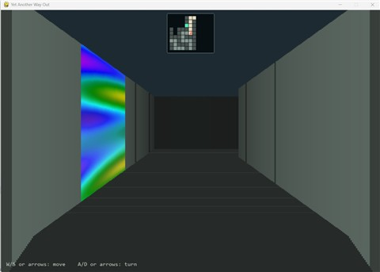

# Yet Another Way Out

Find the way out of the maze.

- Each run generates a randomized 23-by-17 maze, entry position, starting
  heading, and exit wall panel; restarting generates a fresh layout.
- First-person, one-point-perspective view through the maze.
- Use cursor keys or WASD, or a gamepad's left stick, to move and turn.
- Corridors are divided into wall panels one tile deep.
- Walking and 90-degree turns each animate over eight frames.
- The view extends six panels into the corridor.
- Corridor end walls are drawn when they are within view.
- Perpendicular corridors appear as openings beside the forward corridor.
- An ego-centered overlay map keeps the player at the center, forward at the
  top, and reveals nearby explored areas.
- The exit wall panel shimmers with changing plasma colors. Reaching it
  solves the level.

[](doc/yet_another_way_out_1.jpg)

## Usage

From the repository root, start the game with:

```powershell
uv run --project python python/way_out.py
```

Use the cursor keys or WASD to move and turn. A gamepad left stick also
supports movement: up/down walks forward/backward, and left/right turns.
The game opens controllers at startup and when connected later, using
the same input backend as the reviewed gamepad visualizer. Left-stick
axes A0/A1 are polled every frame so held input repeats and releasing or
disconnecting the controller stops repeating movement. The first joystick
turn is immediate; holding left/right repeats 90-degree turns no faster
than every 0.5 seconds, measured between turn starts. Releasing the stick
or changing direction allows a fresh turn without that repeat delay.
Held forward/backward movement continues without this extra delay.
A 0.55 movement deadzone prevents stick drift from moving the player.
Reaching the exit starts the 10-to-1 countdown; after it finishes, press
any key or any gamepad button to generate a new maze. Presses during the
countdown are ignored; press again after the restart prompt appears.

### Gamepad input test

Use [gamepad_test.py](python/script/gamepad_test.py) to inspect gamepad input.
Start the standalone visualizer from the repository root:

```powershell
uv run --project python python/script/gamepad_test.py
```

The reviewed visualizer's device setup and raw input polling live in
[gamepad.py](python/way_out_game/gamepad.py), shared with the game as the
single source of truth for opening devices, connection instance IDs,
hot-plugging, cleanup, and stick axis assignments. The visualizer's 0.15
highlight threshold is intentionally more sensitive than gameplay.

The window highlights held buttons, sticks, triggers, and the D-pad on a
controller silhouette. Numbered readouts show every raw axis, button, and
hat, including controls outside the silhouette's common layout. Raw control
indices vary by device; the silhouette is not a device-specific mapping.
The D-pad supports hat input and raw buttons B11 (up), B14 (right),
B12 (down), and B13 (left). Both the silhouette and numbered button
readouts highlight when these buttons are pressed.
The digital shoulder buttons use B9 (left) and B10 (right), the stick
clicks use B7 (left) and B8 (right), and the middle buttons use B4 (left),
B6 (right), and B15 (upper), and B5 sits between the joysticks.
Axes 4 and 5 are illustrated as triggers, with their initial positions used
as rest values; leave controls released when connecting.
Connect or disconnect gamepads while the window is open, press Tab to
switch between them, and press Escape or close the window to quit.

The visualizer with a connected PS4 controller (click to enlarge):

[![Gamepad input test with a PS4 controller][gamepad-thumb]][gamepad-shot]

[gamepad-thumb]: doc/gamepad_test_thumb.jpg
[gamepad-shot]: doc/gamepad_test.jpg

## Software Architecture

See the [software architecture](./doc/software_architecture.md) for module
responsibilities, input contracts, and game-state transitions. The
[requirements catalog](./doc/requirements.md) records functional and
non-functional requirements with links to their Python tests.

## Tests and Coverage

Run both commands from the `python/` directory. Pytest collects branch data
and enforces a 95% combined-coverage threshold:

```powershell
uv run pytest
uv run python check_coverage.py
```

Pytest reports missed lines and branches, but its threshold is not the
per-metric gate. `check_coverage.py` prints statement, line, function, and
branch percentages separately and fails unless every one is greater than
95%. See [NFR-COV-001][nfr] for the requirement. To also create an HTML
report, run:

```powershell
uv run pytest --cov-report=html
```

Open `python/htmlcov/index.html` from the repository root to inspect the
coverage report.

Function coverage counts named functions with executable statements; a
function is covered when at least one of its statements ran. Module-level
code is excluded from that function count.

## Code Quality

From `python/`, run the configured Python checks:

```powershell
uv run ruff check .
uv run black --check .
uv run flake8 way_out.py way_out_game script tests check_coverage.py
uv run pylint way_out.py way_out_game script tests check_coverage.py
uv run mypy --explicit-package-bases --config-file ..\mypy.ini `
    way_out.py way_out_game script tests check_coverage.py
```

From the repository root, lint the Markdown documentation with:

```powershell
npx --yes markdownlint-cli2 --config .markdownlint.json README.md `
  doc/software_architecture.md doc/requirements.md
```

  [nfr]: doc/requirements.md#nfr-cov-001-strict-per-metric-coverage-floor
