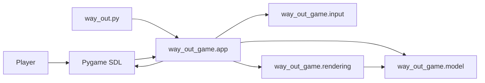
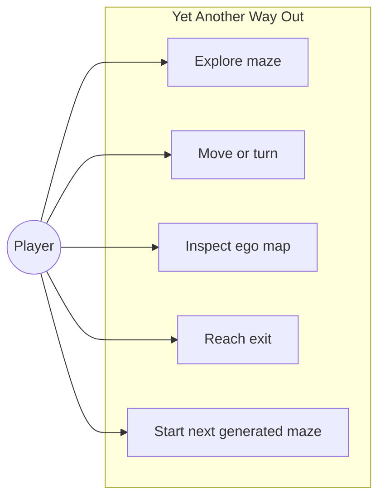
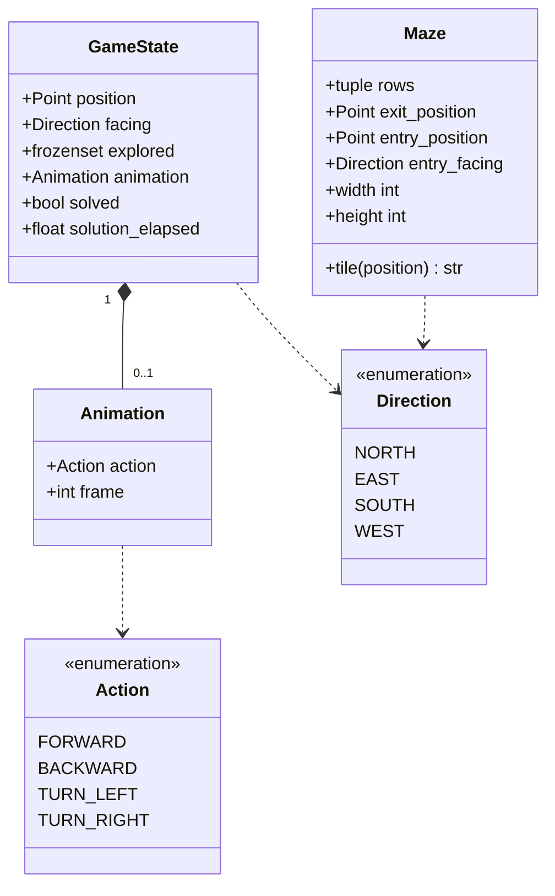
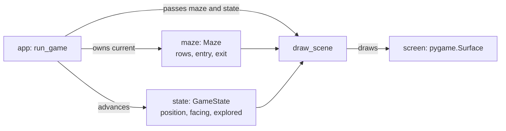
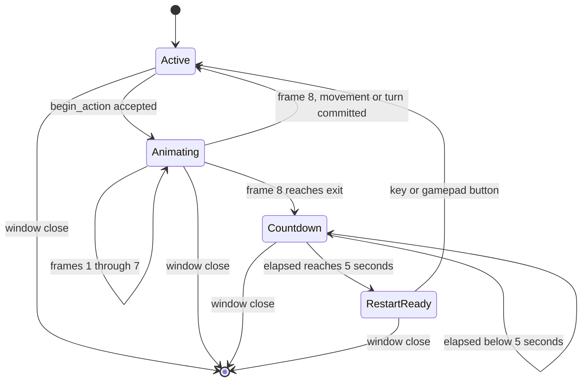
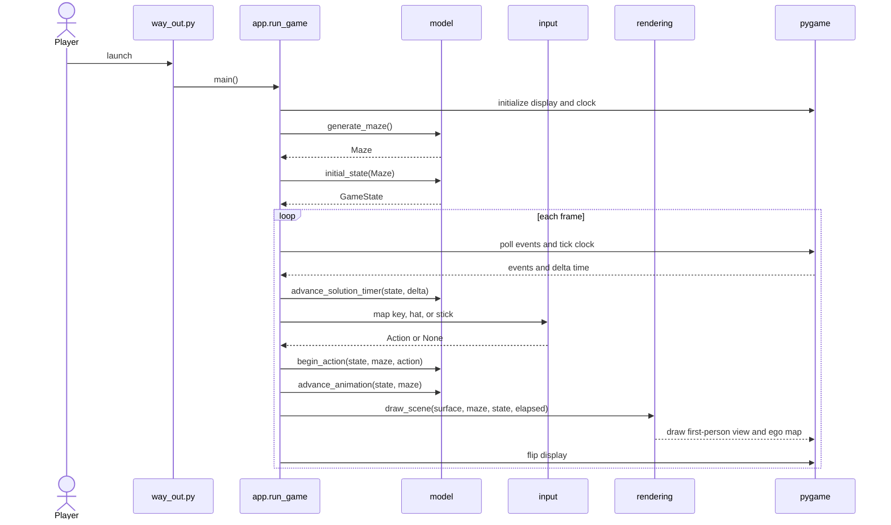
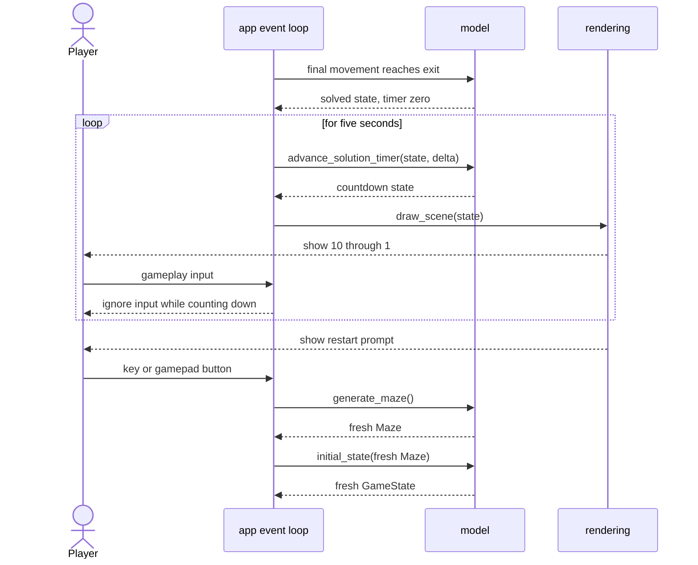
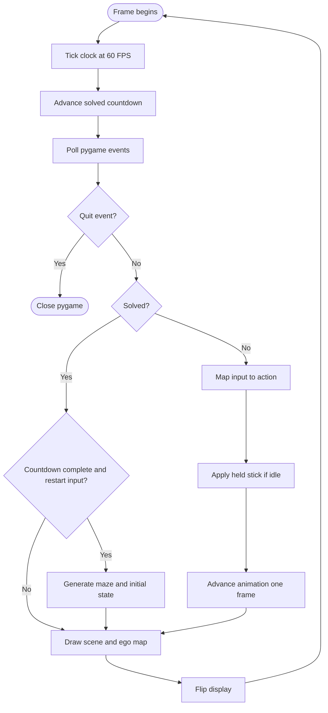
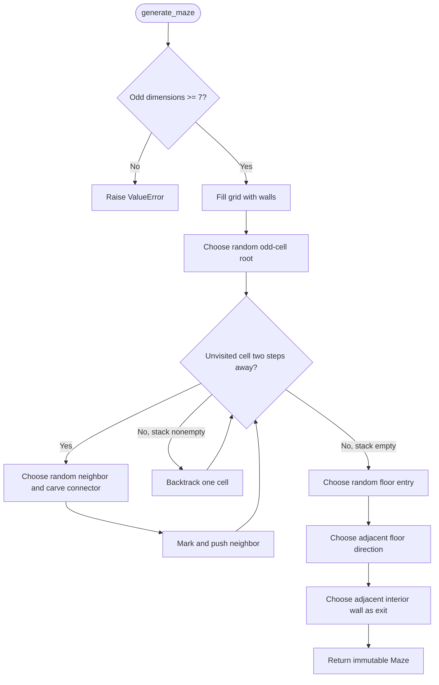

# Software Architecture

## Purpose and Scope

Yet Another Way Out is a single-player, first-person maze game. Each run
generates a randomized 23-by-17 maze with a random floor entry, starting
heading, and reachable exit wall panel. The player explores through a
one-point-perspective view and an ego-centered map.

This document describes the implemented architecture. It distinguishes the
deterministic game rules from pygame's event, timing, and rendering services.

## Feature Overview

- Procedural maze generation, with optional seeds for reproducible runs.
- Random entry position and heading selected from walkable corridors.
- Random interior wall-panel exit adjacent to the connected passage network.
- First-person corridor view with a six-panel depth and panel shading.
- Ego-centered 11-by-9 map that keeps the player centered and forward at top.
- Cursor keys and WASD, plus gamepad stick and hat navigation.
- Eight-frame walking and 90-degree turning animations.
- Two-dimensional animated plasma effect on the exit panel.
- Ten-second-count steps shown for 0.5 seconds each after a win.
- Input lockout during the win countdown, except window close.
- Keyboard or gamepad button starts a newly generated maze after countdown.

## Architecture Style

The game uses a functional core with an imperative pygame shell.

- The core stores maze and game state in frozen dataclasses.
- Core transitions return new state values rather than mutating them.
- Maze generation accepts an optional seed; the runtime uses an unseeded
  generator to create a fresh maze.
- The application owns the clock, event queue, active maze, and current state.
- Rendering reads the maze and state and draws them to a pygame surface.
- Tests use deterministic maze fixtures and seeded generation.

The core is not entirely pure: `generate_maze` uses a local `Random` instance.
Given the same dimensions and seed, it returns the same maze and does not
modify global random state.

## Module Responsibilities

### `python/way_out.py`

Executable entry point. It delegates to `way_out_game.app.main` and contains no
game rules.

### `python/way_out_game/app.py`

Composition root and pygame loop. It initializes pygame, generates the maze,
creates the initial state, polls events, advances countdown and movement,
draws each frame, and replaces both maze and state after a restart.

`handle_event` translates pygame event types into core actions or a restart.
`apply_held_axes` repeats held walking after the previous animation ends,
but spaces held joystick turn starts by at least 0.5 seconds per controller.
The loop opens and tracks controllers through the shared gamepad backend,
polls their left sticks every frame, and releases devices even on failure.
`run_game(max_frames=...)` provides a bounded loop for headless tests.

### `python/way_out_game/gamepad.py`

Single source of truth for controller input, extracted from the reviewed
`python/script/gamepad_test.py`. Both the game and visualizer use `Gamepads`
to open existing and newly attached devices, handle removals by instance ID,
and release hardware. `GamepadState` polls raw axes, buttons, and hats.
Shared axis assignments define A0/A1 as the left stick and A2/A3 as the right.
The visualizer retains its reviewed silhouette and button mappings.

### `python/way_out_game/input.py`

Pure input translation. It maps supported keyboard keys and normalized stick
or hat axes to `Action` values. It does not read pygame's event queue or change
game state.

### `python/way_out_game/model.py`

Game domain types and transitions. It defines `Maze`, `GameState`, `Animation`,
directions, actions, visibility, movement, animation advancement, countdown
timing, and seeded maze generation. It does not import pygame.

### `python/way_out_game/rendering.py`

Pygame presentation. It performs grid DDA ray casting, draws the 3D view and
plasma exit, projects explored cells into the ego map, and draws status,
countdown, and restart prompt.

### Tests and configuration

`python/tests/` contains headless tests for core logic, input mapping, app
events, and rendering. `tests/conftest.py` supplies a small deterministic maze
for cases that need fixed geometry. `python/pyproject.toml` configures uv,
pytest, coverage, Black, Ruff, and Pylint. Flake8 uses `python/.flake8`; strict
Pylance settings are in `.vscode/settings.json`; root `mypy.ini` points Mypy at
the nested Python project.

## Component View



`app` is the only module that coordinates input, state transitions, and
rendering. `input` and `model` remain independent of the display surface.

## Use Cases



The map is updated from explored state, not from an independent map-control
use case. Reaching the exit starts the completion countdown; restarting is
available after that countdown finishes.

## Domain Class Diagram



`Maze` is immutable layout plus entry/exit metadata. `GameState` is the
player's current view of that layout. The application owns the association
between the active maze and its state; the state does not contain a mutable
reference to a maze.

## Runtime Object Snapshot

This example shows the main objects during an active run. Coordinates and
values are illustrative; generated mazes vary by run.



## Input Contracts

`action_for_key(key)` returns an `Action` or `None`.

| Input | Action |
| --- | --- |
| Up arrow or W | Forward |
| Down arrow or S | Backward |
| Left arrow or A | Turn left |
| Right arrow or D | Turn right |
| Any other key | No action |

`action_for_axes(x, y)` accepts normalized numeric axes. Values whose largest
absolute component is at most 0.55 are in the deadzone and return `None`.
Outside it, the larger component wins; vertical wins ties. Negative Y means
forward, positive Y backward, negative X left, and positive X right.

The app maps joystick hats through the same axes contract, inverting the hat's
vertical sign. During normal play, keyboard and hat actions start one
eight-frame action. Left-stick axes A0/A1 are polled per connection instance
every frame, so held input repeats after the previous animation finishes,
and release or removal cannot leave a stale repeating action. Finishing an
already-started eight-frame action is not interrupted by releasing the stick.
The first joystick turn is immediate; holding the same horizontal direction
starts further turns at most once every 0.5 seconds. Repeat deadlines use
elapsed game time and are tracked per controller. Releases, disconnects, and
changes of direction reset the deadline even during animation; a new maze
also clears all turn-repeat state. Forward/backward walking is not throttled.
Keyboard and hat event behavior is unchanged.
The game keeps its 0.55 movement deadzone; the diagnostic visualizer highlights
changes above 0.15 to make small raw inputs visible.

While solved, movement axes, hats, and all other gameplay input are ignored.
Window close always exits. After the five-second countdown, any key,
`JOYBUTTONDOWN`, or `CONTROLLERBUTTONDOWN` generates a new maze and resets the
state. The restart button event itself does not move the new player.

## State and Action Contracts

`initial_state(maze)` uses the maze's entry position and heading. An explicit
position or heading may override either default; the position must be floor.
The initial explored set is the current view.

`begin_action(state, maze, action)` returns the original state when the game
is solved, another animation is active, or a requested step hits a `#` wall.
Otherwise it returns a state with an `Animation(action, frame=0)`. Turns do
not require a free destination cell.

`advance_animation` advances one display frame. The first seven calls advance
the animation frame; the eighth commits the turn or cell move, clears the
animation, and expands explored cells. Entering the exit does not move the
player into the wall panel; it marks the state solved and starts the timer at
zero.

The app adds at most 0.1 seconds to `solution_elapsed` per frame. The visible
number is 10 at time zero and decreases every 0.5 seconds through 1. After
five seconds `solution_countdown` returns `None`, and the renderer shows the
restart prompt.

## Game State Diagram



The active runtime state is the pair `(Maze, GameState)`. Restart replaces
both values together.

## Application Sequence



## Completion and Restart Sequence



## Frame Activity



## Maze Generation Algorithm

`generate_maze(width=23, height=17, seed=None)` validates that dimensions are
odd integers of at least seven. The default 23-by-17 grid is approximately
1.5 times the previous 15-by-11 layout in each dimension.

The generator is an iterative randomized depth-first search, also known as a
recursive-backtracker maze:

1. Fill every grid cell with `#`.
2. Select a random odd-coordinate cell as the DFS root and mark it `.`.
3. Keep a stack of visited odd-coordinate cells. For the top cell, find
   unvisited cells two grid steps away.
4. If a candidate exists, shuffle the candidates, choose one, carve the wall
   between the cells to `.`, mark the new cell `.`, and push it.
5. If no candidate remains, pop the stack and continue backtracking.
6. When the stack is empty, every odd-coordinate cell belongs to one
   connected passage tree. The intervening carved cells form the corridors.
7. Choose an entry uniformly from all floor cells. Choose its starting
   direction from adjacent floor cells, so forward initially faces a
   walkable corridor.
8. Choose an interior `#` cell adjacent to at least one floor cell, and mark
   it `E`. Since all floor cells are connected, the exit is reachable.

The algorithm is iterative, so it avoids recursion-depth limits. For `V`
odd-coordinate cells, depth-first carving is `O(V)`; collecting floor cells
and candidate wall panels is `O(width * height)`. The grid and search stack
use `O(width * height)` space. A local seeded PRNG makes test runs
reproducible.

### Generator Flow



## Ego Map Projection

The map viewport is fixed at 11 columns by 9 rows. The player's cell is always
at the center and the player's forward direction always maps to decreasing
map Y, i.e. toward the top of the display. The screen-right basis is the
player's facing rotated 90 degrees clockwise.

For a world cell offset `(dx, dy)`, forward vector `(fx, fy)`, and right
vector `(rx, ry)`, the map offset is:

```text
map_x = center_x + dx * rx + dy * ry
map_y = center_y - dx * fx - dy * fy
```

Only explored cells that project inside the viewport are drawn. Current-view
cells use a brighter color; walls, exit, unexplored space, and the player
marker use distinct colors. The first-person renderer separately casts one
ray per four horizontal pixels with a 60-degree field of view and a six-cell
maximum depth. Grid DDA finds each ray's first wall or exit. Exit panels use a
time-varying two-dimensional plasma color field.

## Testing and Local Commands

From the `python/` directory:

```powershell
uv run way_out.py
uv run pytest
uv run ruff check .
uv run black --check .
uv run pylint way_out.py way_out_game tests
uv run flake8 way_out.py way_out_game tests
uv run mypy --config-file ..\mypy.ini way_out.py way_out_game tests
uv run python check_coverage.py
```

`uv run pytest` reports branch coverage in the terminal and enforces a 95%
combined minimum through the project's pytest configuration. Then run
`uv run python check_coverage.py` from `python/` to measure statement, line,
function, and branch coverage independently; each must be greater than 95%.
Function coverage counts named functions with executable statements and
considers a function covered when any of its statements ran; module-level
code is excluded.
To add an HTML report, run `uv run pytest --cov-report=html`; the report is
written to `python/htmlcov/` relative to the repository root.

Tests cover seeded generation, entry and exit placement, connectivity, state
transitions, input mappings, countdown timing and lockout, renderer output,
and the ego map's center and orientation. Pygame rendering tests use SDL's
dummy drivers and do not require a visible window.
